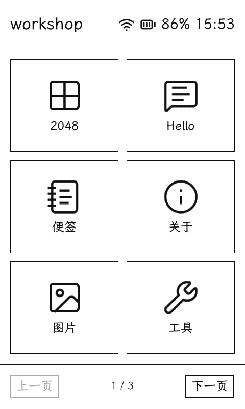

# workshop

<p align="center">
  
</p>

<p align="center">为 OBOOK5 墨水屏打造的轻量应用启动器</p>

<p align="center">
  
  
  
</p>

<p align="center">
  
</p>

## 简介

`workshop` 是一个面向 OBOOK5 墨水屏设备的应用启动器。它基于 LVGL，直接接管
framebuffer 与触摸输入，用纯黑白界面提供应用入口，并通过 OTA 升级包完成部署。

## 特性

- 纯黑白 1-bit 界面，适配墨水屏刷新
- 支持竖屏与横屏布局
- 支持加载自制程序，统一 `app/<id>/` 目录结构
- 支持 OTA 安装，无需拆机

## 安装 workshop

### 准备

```bash
git submodule update --init
pip3 install -r requirements.txt
```

安装 Zig 0.17.1 或更新版本：<https://ziglang.org/download/>

### 构建并安装

```bash
python3 build_apps.py
python3 package_ota.py
sudo python3 jailbreak_ota.py --target <设备IP>
```

然后在设备上打开：

```text
设置 -> 检查更新
```

`build_apps.py` 会构建 workshop、2048 和调试 App。交叉编译参数和手动构建方式见
最后一节。

## 自制 App

### 目录规范

每个 App 放在 `workshop/app/<id>/` 下，结构统一：

```text
app/<id>/
  app.conf
  icon.png
  bin/
  data/
  logs/
```

| 路径 | 说明 |
| --- | --- |
| `app.conf` | App 元信息 |
| `icon.png` | 64x64 App 图标 |
| `bin/` | 可执行文件，路径相对 App 目录；特殊 App 可以为空 |
| `data/` | App 私有数据 |
| `logs/` | App 私有日志 |

### app.conf

```ini
name=Hello
exec=bin/hello
```

- `name`：显示名称
- `exec`：相对 App 目录的可执行文件路径
- `special=return_desktop`：仅用于启动器特殊处理的“返回桌面”

### 图标

App 图标使用 `icon.png`：

- 64x64
- 透明背景
- 黑色线条

### 运行约定

- 设备端 App 必须是 `mipsel-linux-musleabi` 静态可执行文件
- 启动器会以 App 目录作为工作目录执行 `exec`
- `stdout` / `stderr` 写入 `app/<id>/logs/<id>.log`
- 非 0 退出码会显示启动失败对话框，并给出日志路径
- App 数据放 `data/`，日志放 `logs/`
- 界面保持纯黑白 1-bit，不做动画、渐变和阴影
- 普通 App 不要在启动时监听网络端口；调试服务只在需要时由对应 App 自行启动

### 模拟器

```bash
cd workshop
cmake -S . -B build
cmake --build build -j
./build/workshop_sim
```

模拟器需要 CMake 与 SDL2。

## 远程调试

打开设备上的“调试”App，界面会显示当前 IP 和端口。调试服务只在 App 打开期间
运行，返回 workshop 后会自动停止。

```text
tcp/8099  root shell（原始 TCP）
tcp/8098  HTTP 状态/日志
```

### Shell

```bash
nc <设备IP> 8099
```

连接后直接执行命令，例如：

```sh
id
ps
ip addr
ls /user/workshop
```

8099 是原始 TCP shell，没有 PTY/telnet 协商，适合执行命令，不适合全屏交互程序。

### HTTP

```bash
curl http://<设备IP>:8098/status
curl http://<设备IP>:8098/log
curl http://<设备IP>:8098/ping
```

- `/status`：IP、端口、网关、MAC、WiFi、RSSI
- `/log`：调试 App 日志
- `/ping`：连通性检查

> 8099 是无认证的 root shell，只在可信局域网使用，调试完成后关闭调试 App。

## 交叉编译

目标平台是 OBOOK5 的 MIPS32r2，使用 Zig 自带的 musl 工具链编译。

初始化 LVGL 子模块：

```bash
git submodule update --init
```

从仓库根目录构建全部目标：

```bash
python3 build_apps.py
```

等价于分别构建：

```bash
cd workshop
./build_obook.sh
```

```bash
cd workshop/app/debug
./build.sh
```

```bash
cd workshop
zig cc -target mipsel-linux-musleabi -mcpu=mips32r2 -static -Os \
  app/2048/src/game2048.c -o app/2048/bin/2048
```

Zig 不在 `PATH` 时，用 `ZIG` 指定路径：

```bash
cd workshop
ZIG=/opt/zig/zig ./build_obook.sh
```

`build_obook.sh` 的关键参数：

```text
-target mipsel-linux-musleabi
-mcpu=mips32r2
-static
-Os
```

检查产物：

```bash
file workshop/bin/workshop
file workshop/app/2048/bin/2048
file workshop/app/debug/bin/debug
```

正常输出类似：

```text
ELF 32-bit LSB executable, MIPS, MIPS32 rel2, statically linked
```

## 声明

本项目仅供学习、研究和个人测试使用，请勿用于商业用途或任何违法用途。

使用本项目造成的任何后果由使用者自行承担；请遵守设备厂商的服务条款和当地法律法规。
